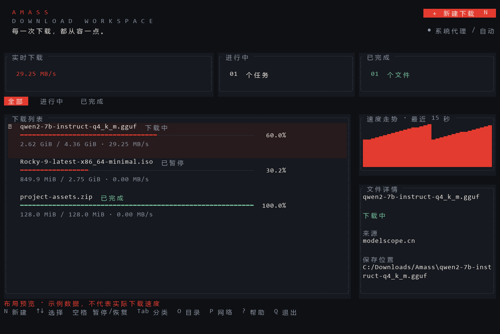

# Amass

以 Rust 编写的 HTTP/HTTPS 下载引擎与终端下载工作台。主题色为 `#e33b2f`，支持进度条、任务管理、暂停恢复和文件校验。当前提供 Windows 终端界面，不包含桌面 GUI。



> 图片中的任务与速度为布局示例，不是性能证明。

## 安装与启动

Windows 源码构建需要 Rust stable 1.89+、MSVC C/C++ 构建工具（用于 bundled SQLite）。

```powershell
# 在项目目录运行；编译并加入当前用户 PATH
.\install-Amass.ps1

# 进入交互式终端界面
Amass
```

已安装后，即使清理项目的构建缓存，`Amass` 命令仍然可用。源码目录中的 `amass.ps1` 也能调用已安装版本。发布版 EXE 不需要安装 Rust。

## 终端操作

| 按键 | 功能 |
| --- | --- |
| N | 新建下载，粘贴链接后 Enter 开始 |
| Tab | 新建窗口切换字段；主页面切换任务分类 |
| ↑ / ↓ | 选择任务，也支持鼠标和滚轮 |
| 空格 / Enter | 暂停、恢复；已完成则打开目录 |
| O | 打开保存目录 |
| P | 切换直连与系统代理，须先暂停活动任务 |
| X / D | 取消任务 / 移除记录，操作前需确认 |
| ? | 帮助 |
| Q / Ctrl+C | 保存并退出，活动任务会暂停 |

默认下载到用户的 `Downloads/Amass`。配置与界面任务库位于 `%LOCALAPPDATA%/Amass`，与旧 CLI 的项目任务库独立。

## 兼容命令行

```powershell
cargo build --release --workspace
.\target\release\rd-cli.exe "https://服务器/文件.zip" -o .\downloads
.\target\release\rd-cli.exe list
.\target\release\rd-cli.exe resume 1
```

不指定 `-n` 时自适应调节连接数；`-n 32` 固定并发。`--direct` 绕过系统代理，`--http2` 允许 ALPN 协商 HTTP/2，`--sha256`/`--blake3` 指定期望校验值。详细参数见 `rd-cli.exe --help`。

## 引擎能力

- HTTP/HTTPS、多连接分段、动态拆分、自动并发、连接池与系统代理。
- Range 续传与远端版本验证；不支持 Range 的服务在恢复时从头重下。
- 退避重试、全局与任务限速、长度校验及可选 SHA-256/BLAKE3。
- 有界磁盘流水线；暂停和重启前等待在途写入结束。
- SQLite 事务检查点与独占锁，避免多进程写入同一份任务文件。

## 开发与测试

```powershell
cargo fmt --all -- --check
cargo clippy --workspace --all-targets --locked -- -D warnings
cargo test --workspace --locked
cargo build --workspace --locked
python tools/test-cli.py target/debug/rd-cli.exe
```

Python 仅用于回归脚本和可选的界面截图渲染，运行 Amass 不需要 Python。单元/集成测试使用本地服务器，不需要下载公网大文件。吞吐测试默认忽略，可显式执行：

```powershell
cargo test --release -p rd-engine --test bench benchmark_matrix -- --ignored --nocapture
```

GitHub Actions 提供 Windows 格式、Clippy、测试、构建和 CLI 回归检查。

## 项目结构与清理

```text
crates/amass/       交互式终端界面
crates/rd-engine/   下载引擎与功能测试
crates/rd-cli/      兼容命令行工具
docs/              使用、架构、配置、性能说明和界面图片
tools/             回归、验收、截图工具
.github/           CI 工作流
```

`target/` 是可再生的编译缓存，不是源码。开发/测试构建已关闭大型调试符号与增量缓存，发布优化不变。需要释放缓存时执行 `cargo clean`，下次构建会重新生成。

源码仓库不包含测试日志、测速下载文件、旧代码备份或重复发布包。任务数据库、下载目录、本机配置、缓存和环境文件已加入 `.gitignore`；请使用 Git 推送源码，不要把本地运行数据拖入 GitHub。

## 文档

- [终端界面](docs/terminal-workspace.md)
- [配置说明](docs/configuration.md)
- [引擎 API 与使用](docs/engine-introduction.md)
- [架构说明](docs/architecture.md)
- [性能记录与测量边界](docs/performance.md)

速度受源站、线路、代理和磁盘影响，不承诺所有环境下固定达到 35 MB/s。
