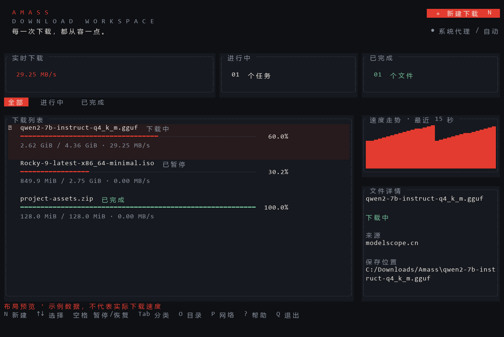
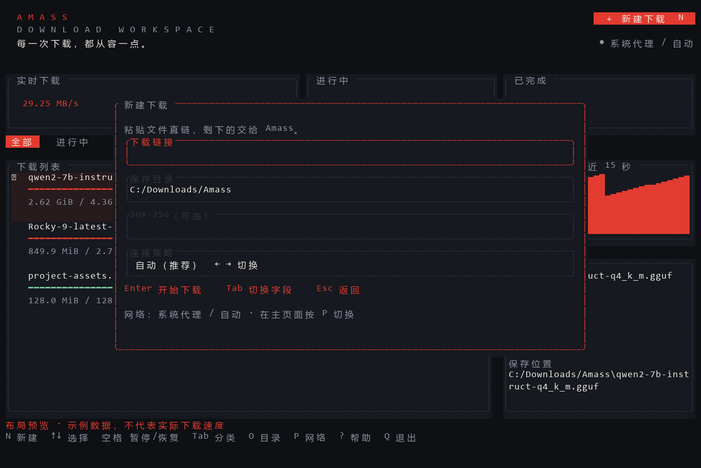

# Amass 终端工作台

## 启动

Windows 安装脚本会安装到 `%LOCALAPPDATA%\Amass\bin\Amass.exe`，并加入用户 PATH。重新打开终端后输入：

```powershell
Amass
```

现有终端若尚未刷新 PATH，可直接运行：

```powershell
& "$env:LOCALAPPDATA\Amass\bin\Amass.exe"
```

其他机器解压发布包后运行 `install-Amass.ps1`。发布包自带 EXE，不需要 Rust。源码构建使用 `cargo build --release --workspace -j 2`。原 `rd-cli.exe` 保留，兼容原命令行操作。

## 页面操作

- `N` 或点击右上角按钮：新建下载。粘贴 HTTP/HTTPS 链接后按 Enter 即可开始。
- `Tab` 在新建窗口中切换保存目录、可选 SHA-256、连接策略；连接策略使用左右键选择自动、16、32、64。
- 任务列表用上下键、J/K、鼠标或滚轮选择。空格/Enter 暂停或恢复；已完成的任务按 Enter 打开目录。
- 主页面 `Tab` 切换全部、进行中、已完成；`O` 打开保存目录。
- `P` 切换直连/系统代理；先暂停所有活动任务，避免正在进行的请求悄悄改变路由。
- `X` 取消、`D` 移除记录，都需要确认。未完成的数据会清理，已完成的文件保留。
- `?` 帮助；`Q`/Ctrl+C 保存退出，等待磁盘写入结束后暂停活动任务。

主题色为 `#e33b2f`，搭配炭黑背景、暖白正文、灰色次要信息、绿色完成状态。最小尺寸为 64×22；宽度达到 110 列会显示右侧文件详情与速度走势。速度、百分比、剩余时间均来自实际任务状态；完成前落盘和校验期间会提示稍候。

默认配置位于 `%LOCALAPPDATA%\Amass\amass.toml`，任务库为同目录的 `tasks.db`，下载目录默认是用户的 `Downloads\Amass`。保存目录和网络模式会记住。这套任务库与旧 CLI 项目数据库独立，旧下载文件不受影响。自定义配置可用 `Amass --config PATH`，直连启动可用 `Amass --direct`。

预览图由实际 Ratatui 渲染缓冲生成，任务与速度为明确标注的示例，不能作为性能证据：





## 引擎与性能

有界写入队列、暂停屏障、重试及不支持 Range 的恢复行为，详见[引擎说明](engine-introduction.md)。测量数据与性能边界见[性能记录](performance.md)。

源码仓库只保留正式文档与界面 PNG。原始测试日志、旧发布包及生成截图所用 JSON 都不是运行依赖，不纳入仓库。需要重新生成界面预览时，可使用 `Amass --preview PATH` 输出渲染数据，再运行 `tools/render-terminal-preview.py`（需要 Pillow 和 Windows 字体）。
